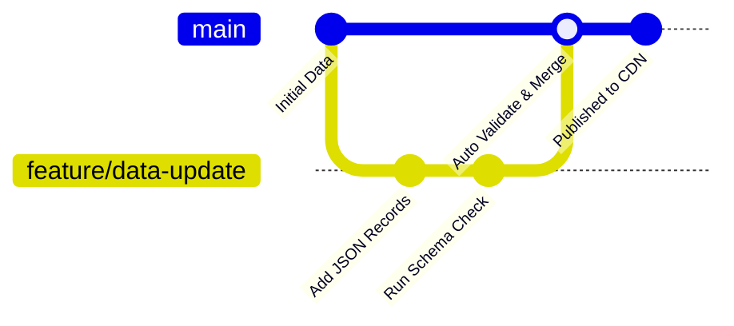

<div align="center">

# ⚡ JSON Repository Engine

<p align="center">
  <strong>High-performance, schema-validated static JSON data store & CDN repository.</strong>
</p>

<!-- Animated SVG Banner -->
<p align="center">
  
</p>

<!-- Dynamic Status Badges -->
<p align="center">
  <a href="#"></a>
  <a href="#"></a>
  <a href="#"></a>
  <a href="#"></a>
</p>

<!-- Animated Typing Terminal Headline -->


---

</div>

<div align="center">
  
</div>

## 📂 Architecture

```plaintext
.
├── .github/
│   └── workflows/
│       └── validate.yml       # Automated JSON lint & schema verification
├── schemas/                   # Draft 2020-12 schema contracts
│   ├── config.schema.json
│   └── records.schema.json
├── data/                      # Production datasets
│   ├── production/
│   │   └── config.json
│   └── reference/
│       └── records.json
├── scripts/
│   └── validate.js            # Node-based Ajv/JSON schema validator
├── package.json
└── README.md
```

<div align="center">
  
</div>

## ⚙️ Schema Verification

All data committed under `/data` must strictly validate against the corresponding JSON schemas in `/schemas`.

```bash
# Install local validation tooling
npm install

# Run schema validation suite
npm run validate

# Format and check syntax structure
npm run lint:json
```

<div align="center">
  
</div>

## 🚀 Fast Fetch API

<details open>
<summary><b>Fetch via cURL / CLI</b></summary>

```bash
curl -s -H "Accept: application/json" \
  https://raw.githubusercontent.com/<username>/<repo-name>/main/data/reference/records.json
```
</details>

<details>
<summary><b>Fetch via Node.js (ESM / Fetch API)</b></summary>

```javascript
const endpoint = "https://raw.githubusercontent.com/<username>/<repo-name>/main/data/reference/records.json";

try {
  const res = await fetch(endpoint);
  if (!res.ok) throw new Error(`HTTP error! status: ${res.status}`);
  const data = await res.json();
  console.log(data);
} catch (error) {
  console.error("Fetch failure:", error);
}
```
</details>

<details>
<summary><b>Fetch via Python</b></summary>

```python
import requests

url = "https://raw.githubusercontent.com/<username>/<repo-name>/main/data/reference/records.json"
response = requests.get(url, timeout=10)
response.raise_for_status()

data = response.json()
print(data)
```
</details>

<div align="center">
  
</div>

## 🛠️ Contribution Workflow



1. Fork the repository and create an isolated branch:
   ```bash
   git checkout -b feature/update-records
   ```
2. Commit your valid JSON payload:
   ```bash
   git commit -m "feat(data): add dataset records"
   ```
3. Push and submit a Pull Request. CI pipeline will automatically execute strict syntax and schema checks.

<div align="center">
  
</div>

## 📜 License

Distributed under the **MIT License**. See [`LICENSE`](LICENSE) for detailed terms.

<div align="center">
  
</div>
